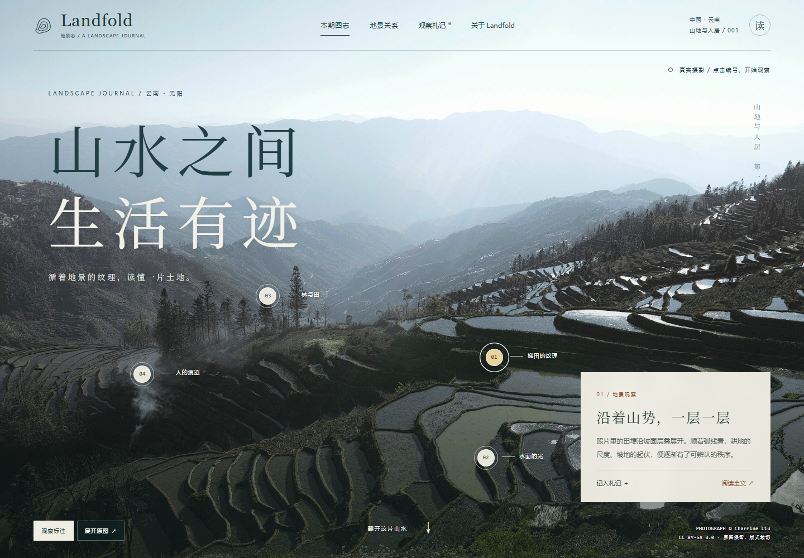

# Landfold · 地景志

**An interactive geography journal exploring the connections between land, water, and people through photography and visual storytelling.**

山水之间，生活有迹。循着地景的纹理，读懂一片土地。

[Visit Landfold](https://sharkerswag.github.io/Landfold/) · [Photography & sources](THIRD_PARTY_NOTICES.md) · [Design direction](DESIGN.md)



Landfold 通过真实风景摄影、可点击的观察点与有来源的解释，呈现地理景观与人地关系。第一期从云南元阳的梯田开始：田埂的纹理、水面的光、林与田的边界，以及人留在山地中的痕迹。

## Current experience

- Open an immersive photographic cover, then turn through a four-chapter editorial issue.
- Explore an original, interactive forest–village–terraces–river schematic with sourced explanations.
- Switch between two photographic folios and view all three photographs without layout cropping, with credits and licenses.
- Read four observations through photographic details, regional context and questions.
- Write personal observations, save them in this browser and export the notebook as Markdown. Saved notes can be edited or removed.
- Share a direct link to a selected observation through URL fragments.
- Use the same experience on desktop and mobile.

The [Quanfuzhuang investigation](https://sharkerswag.github.io/Landfold/investigate.html) lets readers draw a line on a published land-use map, inspect one sample at a time, and pin a second line for comparison. Selecting a count highlights the matching sample ranges. A shared link restores both lines and the highlighted class, and the comparison can be downloaded as Markdown. The same page enables the DeepSeek Agent when served locally with model credentials. Each reply has map checks that restore the selections from that turn.

The [water-source comparison](https://sharkerswag.github.io/Landfold/investigate.html#view=recharge&months=2015-07%2C2016-04) charts monthly precipitation and groundwater shares from Liu et al. (2022), Table 2. Select two months to calculate the difference in percentage points. The values are study estimates of source composition. Absolute recharge volumes require additional data.

Notebook data stays in the current browser's local storage, with no upload or cross-device synchronization. If storage is unavailable, the interface reports that notes are session-only and offers export. Clearing website data removes saved notes.

## Local development

No dependencies or build step are required. Use Node.js 20.12 or later. For the Agent, copy `.env.example` to `.env` and set `LANDFOLD_API_KEY` to your DeepSeek API key. The example selects `deepseek-flash` on the official DeepSeek endpoint. Keep the key in `.env` or the server environment.

```sh
npm run dev
```

Open **http://127.0.0.1:4180/Landfold/**. The local server uses the same project path as GitHub Pages so relative assets and module imports can be checked before publication.

Open **http://127.0.0.1:4180/Landfold/investigate.html** to ask about the current line or month pair. The server loads [the investigation Skill](skills/check-transect/SKILL.md), sends the tool schemas for the current view, executes the requested calculations and source lookups, and sends the results back to the model. Conversation memory retains up to eight completed turns in a server session across both views. Refreshing the page starts a new conversation. Export saves the visible conversation with both kinds of selection and their sources as Markdown.

For a review run, start with “穿过村寨”, pin it as the reference, and switch to “沿梯田带”. Ask which line sampled a settlement and whether the map establishes elevation. The reference has 8 settlement readings out of 55 points, and the current line has 0 out of 45. Use the links in the answer to check the cited material. Run `npm test` for the sampling and tool-loop regression checks. See the [iteration review](REVIEW.md) for tested behavior and remaining gaps.

The static Pages site supports map sampling, water-source comparisons and sources. Model calls run from the local server. The evidence map is a published land-use figure, so the line uses normalized image coordinates. Counts describe pixels sampled along the selected line. Verifying altitude or channel direction would require geographically aligned data.

## GitHub Pages

This is an independent project site backed by **SharkerSwag/Landfold**. It does not require changing a personal homepage repository.

Publication source:

- Branch: `main`
- Folder: `/docs`
- URL: **https://sharkerswag.github.io/Landfold/**

Pushes to `main` update the published site after GitHub Pages finishes its deployment. `docs/.nojekyll` keeps this a plain static site.

## Project layout

```text
docs/                   Public website and static assets
  app.js                Diagram, folio, reader and local notebook interactions
  content.js            Curated geography and photography metadata
  styles.css            Photographic cover and base reader layouts
  journal.css           Editorial issue, diagram, typography and responsive layouts
scripts/serve.mjs       Local preview server
server/                Local conversation endpoint and Agent tool loop
skills/check-transect/ Source verification workflow loaded by the Agent
scripts/derive-land-cover.py Regenerate the sampling grid from the published map
scripts/refresh-font.py Refresh the Chinese font subset after text changes
THIRD_PARTY_NOTICES.md   Photographer credits, sources and licenses
DESIGN.md               Selected direction and design archive
```

## Content and photography

The photographs are authentic, attributed images from Wikimedia Commons. The two terrace originals are retained unchanged; the village photograph uses Wikimedia's resized rendition with complete composition. Layout crops and interactive annotations are separate webpage elements. The photographers' original licensing terms continue to apply. Details are in [THIRD_PARTY_NOTICES.md](THIRD_PARTY_NOTICES.md).

Chinese display typography uses a self-hosted Noto Serif SC subset (SIL OFL 1.1), so visitors do not need access to external font servers. After changing publication text, an editor can refresh it with `python scripts/refresh-font.py`. Python is not required to run the website.

Photographic observations are distinguished from regional explanations. Regional context is based on the UNESCO World Heritage Centre's [Cultural Landscape of Honghe Hani Rice Terraces](https://whc.unesco.org/en/list/1111/). The site does not present inferred water routes, unidentified villages or invented elevations as measured data.

No open-source license has been selected for the project code yet. Third-party photographic licenses are explicitly documented and are not replaced by the code's licensing status.
